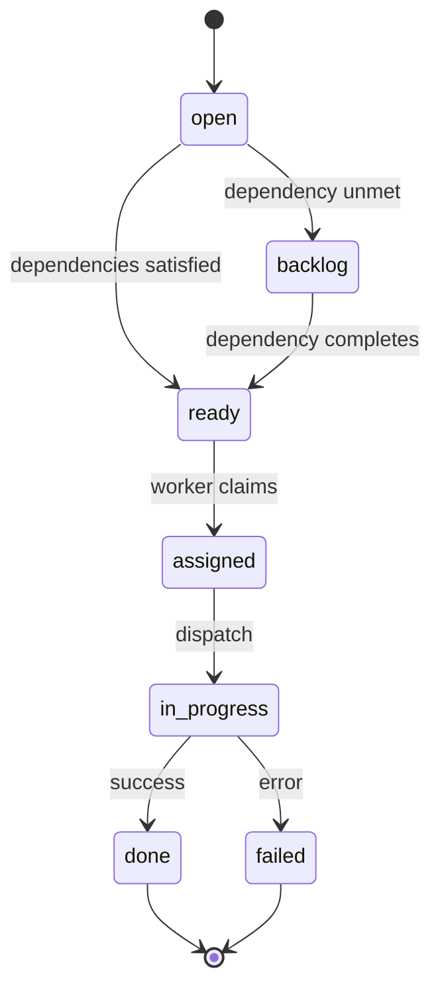

# Tasks

Tasks are the atomic units of work within a [Project](./index). Each task carries a human-readable title, detailed description, acceptance criteria, priority, type, complexity, and can be assigned to either a single agent **or** a full routine — never both.

## Task Lifecycle



## Status Reference

| Status | Description | User Settable? |
|--------|-------------|----------------|
| `open` | Initial state after creation | Yes |
| `backlog` | Waiting on unmet dependencies | No (auto) |
| `ready` | All dependencies satisfied | Yes |
| `assigned` | Claimed by a worker | No |
| `in_progress` | Currently executing | No |
| `done` | Successfully completed | No |
| `failed` | Execution failed | No |

## Task Fields

```typescript
interface Task {
  // Required
  title: string;           // Human-readable name (up to 500 chars)
  
  // Optional
  description?: string;   // Detailed explanation
  acceptance_criteria?: string;  // Defines "done" for gates
  status?: TaskStatus;    // Defaults to "open"
  priority?: Priority;   // low | medium | high | critical
  type?: TaskType;        // bug | feature | task | improvement
  complexity?: number;   // 1-5 for estimation
  tags?: string[];        // Filtering labels
  slug?: string;          // Auto-generated, unique per project
  metadata?: Record<string, unknown>;  // Arbitrary key-value
  
  // Assignment (exactly one OR the other)
  assigned_agent_id?: string;  // Single agent execution
  routine_id?: string;          // Routine execution
}
```

## Assignment Rules

A task **must** have **exactly one** of:

- `assigned_agent_id` → Executes as a single agent call
- `routine_id` → Executes through a full routine (multiple steps, gates, councils)

<Callout type="warning">
Setting both `assigned_agent_id` and `routine_id` on the same task is rejected. Setting one clears the other.
</Callout>

## Dependencies

Tasks can depend on other tasks **within the same project**:

- A task cannot depend on itself
- Circular dependencies are detected and rejected
- A task moves from `backlog` → `ready` when **all** dependencies reach a terminal state (`done` or `failed`)
- Execution order uses topological sort with `order_index` as tiebreaker

## Creating Tasks

From the project dashboard:

1. Navigate to your project
2. Click **Add Task** in the Tasks panel
3. Enter a clear, action-oriented title
4. Add a description and acceptance criteria
5. Set priority and complexity
6. Assign to an agent **or** routine (not both)
7. Add any required tags or dependencies

<Callout type="info">
Always include meaningful `acceptance_criteria` — this is the contract between the task and any gate that evaluates it.
</Callout>